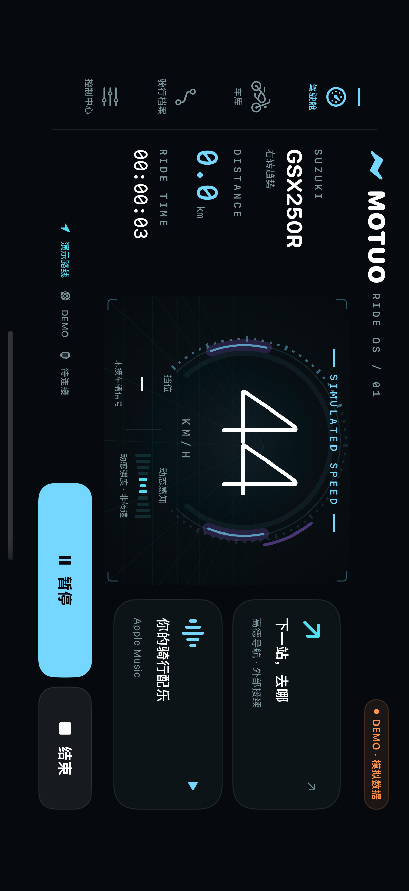

# Motuo

原生 iOS 18+ / watchOS 11+ 摩托骑行应用：赛博仪表、离线骑行记录、Apple Music、Watch 反馈、配件协议和带原页引用的维修手册助手。首个车型样本是 Suzuki GSX250R。

**0.1.0 (1) 已通过Apple处理并分发至TestFlight内部组，本人可接受邀请安装。** 实际iPhone/Watch安装和实车验收仍待完成。 2026-09-20 最终模拟器31单元＋2 UI测试通过。NAS曾完成API/AI smoke，但当前节点离线，正式手册导入尚未完成。实际证据与待验收事项见 [STATUS](docs/STATUS.md)。

**下一版先评审 HTML 效果：** [打开独立交互原型](prototypes/motuo-v2/index.html) · [预览方式与验收](prototypes/motuo-v2/README.md)。当前以用户提供的《小米YU7界面设计.pdf》物理第 10–11 页仪表为主要视觉基础：黑底、大号白色速度与宽扁全景仪表；日常模式使用持续起伏、左右游动的蓝色波面和独立音乐控制，无地图的运动模式提供霓虹穿梭、琥珀扇面、冰蓝脉冲、紫夜光束四种主题。最新取消数字 RPM，以声浪趋势光带和正负加速度双向光条呈现动感；GPS 缺失加入有锚点、连续校准 IMU 的最多15秒估速演示。现已接入与 SU7 项目同路线的 Three.js 实时 3D 车库，支持旋转、缩放、分区改色及同一画布出发；但通用跑车占位模型已被用户否定，正式 GSX250R 模型仍待取得和验收。见 [3D 模型与来源核对](docs/research/vehicle-3d-20260920.md)。前轮熊猫概念图保留为历史资产，见 [转场调研](docs/research/panda-departure-20260920.md)。见 [本轮设计与来源](docs/design/vehicle-sound-transition-20260920.md)。声浪变化来自独立的麦克风或显式 DEMO 输入。见 [YU7 参考观察与数据映射](docs/research/yu7-reference-20260920.md)。大说明卡仍只出现 2.8 秒，随后隐藏；两模式开始骑行后均隐藏品牌栏和导航，暂停保持页面内全屏，结束进入复盘并恢复。 最新按重力摩托体验方向增加霓虹穿梭、持续装饰动效和显式“动效预演”，见 [动效世界](docs/research/motion-worlds-20260920.md)。

麦克风默认关闭，用户显式启用后通过独立 `getUserMedia` 在本机计算 RMS、FFT 和波形，不保存原音、不上传、不回放；模拟声浪必须另行选择并标注。音乐保留独立试听和控歌，不驱动特效；当前尚不能从混合环境声中分辨发动机或识别油门、RPM、负载、挡位。原生 App 尚未按原型修改，仍须先确认 HTML 再迁移与发布；真实输入和实车识别边界见 [骑行状态与声浪反馈](docs/RIDE_STATES.md)。地图方向已按用户要求改为完全开源，国内也不依赖高德；正式数据与导航仍待接入。



## 已实现

- 横竖屏 HUD、动画能量环、车库、校准、音乐、骑后复盘和轨迹回放；演示与真实数据分开。
- CoreLocation / CoreMotion 采集，SwiftData 元数据，带校验和的本地遥测块；暂停、继续、强杀恢复、断网后重试同步。
- 速度有效性、加减速、转向和疑似换挡事件；缺测保持未知，不猜测实际挡位、转速、油量或精确车辆倾角。
- MusicKit 授权、订阅判断、曲目搜索、歌单和播放控制；当前安装版仍有高德地点交接与外部导航入口；下一版在 HTML 评审后替换为开源地图/导航，见 [开源地图方案](docs/OPEN_MAPS.md)。
- Watch 状态与摘要，带去重、过期和冷却的前台可达触觉事件；BLE / Bonjour 发现、HUD 状态协议和本机模拟器。
- 车辆和保养记录、PDF 分块导入、中文检索、物理页引用及 PDFKit 跳页；NAS 异步 AI 总结与无依据时的原文/本地回退。
- 个人学习候选：只用同校准下的实测记录及人工确认窗口，按整次骑行留出验证，显式启用和回退。当前验收状态见 [STATUS](docs/STATUS.md)，不宣称已获得实车识别准确率。

## 目录

| 路径 | 内容 |
|---|---|
| `prototypes/motuo-v2/` | 独立 HTML 效果预览，可显式启用本机麦克风；不含真实定位或服务调用 |
| `ios/` | SwiftUI iPhone / Watch 工程、单元与 UI 测试 |
| `server/` | TypeScript / Fastify API、PostgreSQL schema 与集成测试 |
| `worker/` | Python PDF 排版抽取、中文分词、OCR、任务恢复 |
| `deploy/` | 独立 NAS Compose、Nginx 模板、备份恢复及回滚验证 |
| `scripts/` | Apple 发布、NAS 部署、手册验收与 HUD 模拟器 |
| `fixtures/` | 41 个手册证据问题及实时状态边界问题 |
| `docs/` | API 契约、协议、平台接续和分层验收记录 |

## 本机开发

iOS 需要 Xcode、iOS / watchOS SDK 与 XcodeGen。完整 iPhone 目标包含 Watch，必须安装对应 watchOS 组件。

```sh
cd ios
xcodegen generate
xcodebuild -project Motuo.xcodeproj -scheme Motuo \
  -configuration Debug -destination 'generic/platform=iOS Simulator' build
```

App 中可直接进入明确标注的演示骑行；真实采集按功能请求定位、运动、蓝牙和音乐权限。构建与模拟器说明见 [ios/README](ios/README.md)。自有 Apple Team 构建应配置自己的签名，不复制其他项目私钥。

API 使用 Node.js 22+ 和 PostgreSQL。环境变量须在私有运行环境中设置；应用不会自动加载 `.env`。

```sh
cd server
npm ci
# 设置 DATABASE_URL 和独立的 DATA_DIR 后运行：
npm run migrate
npm run dev
```

首个设备在同一环境运行 `npm run pair` 获得15分钟有效的一次性配对码。已有账户的后续配对应传入该账户 `OWNER_ID`。配对码和设备令牌都是凭据，不贴入日志或文档。详见 [server/README](server/README.md)。

Python 3.12 worker 使用锁定依赖，并需要 Poppler、Tesseract 及 `chi_sim+eng`；它与 API 使用同一个专用数据库和数据目录。[worker/README](worker/README.md) 包含离线抽取和队列启动命令。

## 验证与发布

```sh
cd server
npm run check
npm run test:integration
npm run build
```

集成测试创建并清理自己的临时 PostgreSQL；不要把 `TEST_DATABASE_URL` 指向生产库。分层验收记录：

- [当前状态](docs/STATUS.md) · [API 契约](docs/CONTRACT.md)
- [手册抽取](docs/manual-acceptance.md) · [本机 HTTP 引用问答](docs/manual-api-acceptance.md)
- [NAS 运行与恢复](docs/nas-acceptance.md) · [公网 DNS/TLS](docs/edge-acceptance.md)
- [Apple / TestFlight 接续](docs/APPLE_RELEASE.md) · [实车验收清单](docs/PHYSICAL_ACCEPTANCE.md)
- [配件协议与模拟器](docs/ACCESSORY_PROTOCOL.md)

部署目标为 `motuo.yundongyl.cn → 上海 Nginx/TLS → Tailscale → NAS /volume1/docker/motuo`，API 端口3020，独立数据库、容器、网络和密钥。脚本只用于已授权的 Motuo 资源；共享 Nginx 必须保留原配置、备份、检查并 reload，不能替换其他项目部署。

## 数据与功能边界

维修手册、凭据、遥测和个人轨迹不进入 Git。原 PDF 保留不改写；正文是知识证据，不能改变系统权限或执行工具。参数回答优先原文引用，静态手册不能证明当前胎压、挡位或零件故障。

动感能量环不是发动机转速或功率。Watch 消息发送成功不等于真表振动成功；不使用虚假锻炼会话获取后台时间。发现蓝牙设备不等于已适配其协议。外部导航交接不代表能获取高德转向指令。

实时效果目前由 SwiftUI Canvas 和渐变实现；Lottie 为可选接入，Metal 实验源码未纳入构建。已保留 [SteedPilot MIT 协议参考与许可](docs/licenses/SteedPilot-PROTOCOL-reference.md)；其硬件原型不作为本产品的实车兼容性承诺。
